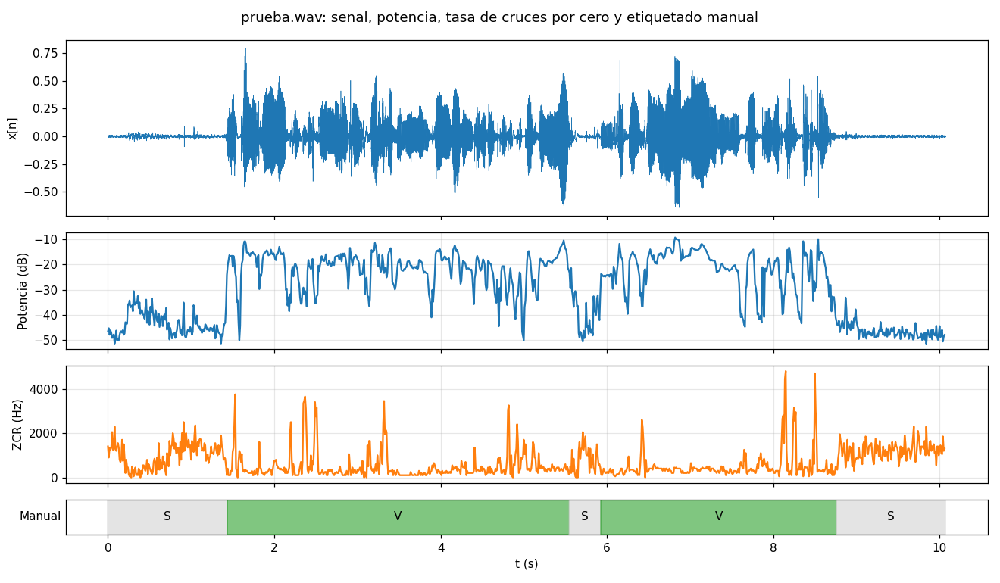
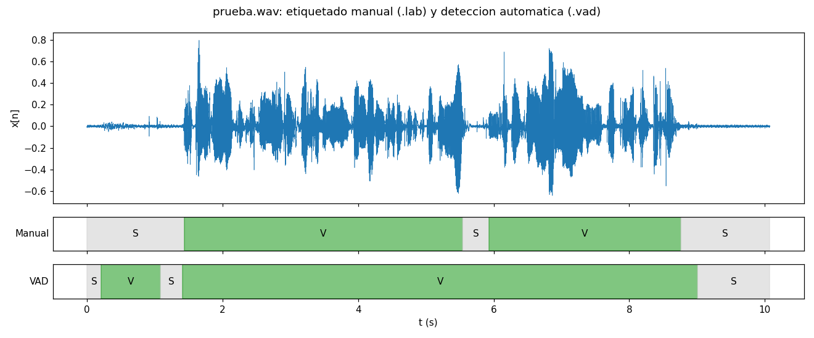
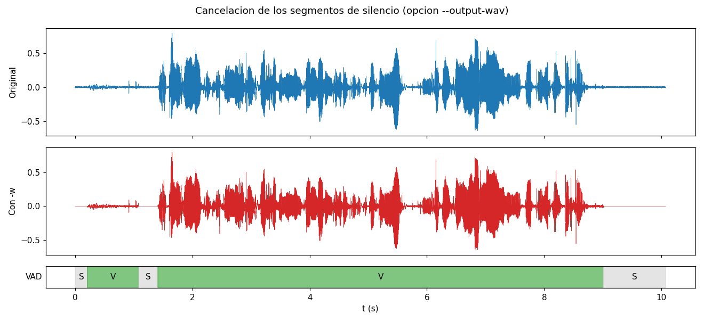
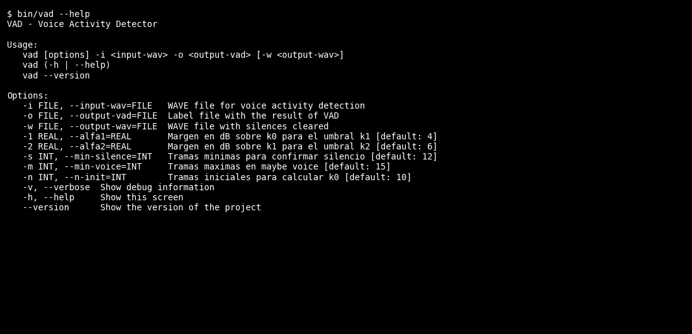

Marc Arbelo Liria i Xavier Moreno Carril
========================================

PAV - P2: detección de actividad vocal (VAD)
============================================

Esta práctica se distribuye a través del repositorio GitHub [Práctica 2](https://github.com/albino-pav/P2),
y una parte de su gestión se realizará mediante esta web de trabajo colaborativo.  Al contrario que Git,
GitHub se gestiona completamente desde un entorno gráfico bastante intuitivo. Además, está razonablemente
documentado, tanto internamente, mediante sus [Guías de GitHub](https://guides.github.com/), como
externamente, mediante infinidad de tutoriales, guías y vídeos disponibles gratuitamente en internet.


Inicialización del repositorio de la práctica.
----------------------------------------------

Para cargar los ficheros en su ordenador personal debe seguir los pasos siguientes:

*  Abra una cuenta GitHub para gestionar esta y el resto de prácticas del curso.
*  Cree un repositorio GitHub con el contenido inicial de la práctica (sólo debe hacerlo uno de los
  integrantes del grupo de laboratorio, cuya página GitHub actuará de repositorio central del grupo):
  -  Acceda la página de la [Práctica 2](https://github.com/albino-pav/P2).
  -  En la parte superior derecha encontrará el botón **`Fork`**. Apriételo y, después de unos segundos,
    se creará en su cuenta GitHub un proyecto con el mismo nombre (**P2**). Si ya tuviera uno con ese 
    nombre, se utilizará el nombre **P2-1**, y así sucesivamente.
*  Habilite al resto de miembros del grupo como *colaboradores* del proyecto; de este modo, podrán
  subir sus modificaciones al repositorio central:
  -  En la página principal del repositorio, en la pestaña **:gear:`Settings`**, escoja la opción 
    **Collaborators** y añada a su compañero de prácticas.
  -  Éste recibirá un email solicitándole confirmación. Una vez confirmado, tanto él como el
    propietario podrán gestionar el repositorio, por ejemplo: crear ramas en él o subir las
    modificaciones de su directorio local de trabajo al repositorio GitHub.
*  En la página principal del repositorio, localice el botón **Branch: master** y úselo para crear
  una rama nueva con los primeros apellidos de los integrantes del equipo de prácticas separados por
  guion (**fulano-mengano**).
*  Todos los miembros del grupo deben realizar su copia local en su ordenador personal.
  -  Copie la dirección de su copia del repositorio apretando en el botón **Clone or download**.
    Asegúrese de usar *Clone with HTTPS*.
  -  Abra una sesión de Bash en su ordenador personal y vaya al directorio **PAV**. Desde ahí, ejecute:

    ```.sh
    git clone dirección-del-fork-de-la-práctica
    ```

  -  Vaya al directorio de la práctica `cd P2`.

  -  Cambie a la rama **fulano-mengano** con la orden:

    ```.sh
    git checkout fulano-mengano
    ```

*  A partir de este momento, todos los miembros del grupo de prácticas pueden trabajar en su directorio
  local del modo habitual, usando el repositorio remoto en GitHub como repositorio central para el trabajo colaborativo
  de los distintos miembros del grupo de prácticas o como copia de seguridad.
  -  Puede *confirmar* versiones del proyecto en su directorio local con las órdenes siguientes:

    ```.sh
    git add .
    git commit -m "Mensaje del commit"
    ```

  -  Las versiones confirmadas, y sólo ellas, se almacenan en el repositorio y pueden ser accedidas en cualquier momento.

*  Para interactuar con el contenido remoto en GitHub es necesario que los cambios en el directorio local estén confirmados.

  -  Puede comprobar si el directorio está *limpio* (es decir, si la versión actual está confirmada) usando el comando
    `git status`.

  -  La versión actual del directorio local se sube al repositorio remoto con la orden:

    ```.sh
    git push
    ```

    *  Si el repositorio remoto contiene cambios no presentes en el directorio local, `git` puede negarse
      a subir el nuevo contenido.

      -  En ese caso, lo primero que deberemos hacer es incorporar los cambios presentes en el repositorio
        GitHub con la orden `git pull`.

      -  Es posible que, al hacer el `git pull` aparezcan *conflictos*; es decir, ficheros que se han modificado
        tanto en el directorio local como en el repositorio GitHub y que `git` no sabe cómo combinar.

      -  Los conflictos aparecen marcados con cadenas del estilo `>>>>`, `<<<<` y `====`. Los ficheros correspondientes
        deben ser editados para decidir qué versión preferimos conservar. Un editor avanzado, del estilo de Microsoft
        Visual Studio Code, puede resultar muy útil para localizar los conflictos y resolverlos.

      -  Tras resolver los conflictos, se ha de confirmar los cambios con `git commit` y ya estaremos en condiciones
        de subir la nueva versión a GitHub con el comando `git push`.


  -  Para bajar al directorio local el contenido del repositorio GitHub hay que ejecutar la orden:

    ```.sh
    git pull
    ```
  
    *  Si el repositorio local contiene cambios no presentes en el directorio remoto, `git` puede negarse a bajar
      el contenido de este último.

      -  La resolución de los posibles conflictos se realiza como se explica más arriba para
        la subida del contenido local con el comando `git push`.


*  Al final de la práctica, la rama **fulano-mengano** del repositorio GitHub servirá para remitir la
  práctica para su evaluación utilizando el mecanismo *pull request*.
  -  Vaya a la página principal de la copia del repositorio y asegúrese de estar en la rama
    **fulano-mengano**.
  -  Pulse en el botón **New pull request**, y siga las instrucciones de GitHub.


Entrega de la práctica.
-----------------------

Responda, en este mismo documento (README.md), los ejercicios indicados a continuación. Este documento es
un fichero de texto escrito con un formato denominado _**markdown**_. La principal característica de este
formato es que, manteniendo la legibilidad cuando se visualiza con herramientas en modo texto (`more`,
`less`, editores varios, ...), permite amplias posibilidades de visualización con formato en una amplia
gama de aplicaciones; muy notablemente, **GitHub**, **Doxygen** y **Facebook** (ciertamente, :eyes:).

En GitHub. cuando existe un fichero denominado README.md en el directorio raíz de un repositorio, se
interpreta y muestra al entrar en el repositorio.

Debe redactar las respuestas a los ejercicios usando Markdown. Puede encontrar información acerca de su
sintáxis en la página web [Sintaxis de Markdown](https://daringfireball.net/projects/markdown/syntax).
También puede consultar el documento adjunto [MARKDOWN.md](MARKDOWN.md), en el que se enumeran los
elementos más relevantes para completar la redacción de esta práctica.

Recuerde realizar el *pull request* una vez completada la práctica.

Ejercicios
----------

### Etiquetado manual de los segmentos de voz y silencio

- Grabe una señal de voz en la que haya distintos segmentos de voz y silencio. La señal debe ser de un
  solo canal (monofónica), grabada con una frecuencia de muestreo de 16 kHz y codificada con PCM lineal
  de 16 bits.

  Nombre a la señal como `pav_GGP#.wav`, donde GG es el grupo de clase (por ejemplo, 21 o 41), P es el
  número del puesto de trabajo y # es el número de señal (si sólo se entrega una señal, este número es
  1).

  > NOTA: es habitual que las grabaciones empiecen con un segmento de silencio de potencia extremadamente
  > bajo; mucho más bajo que el nivel de ruido normal durante el resto de la señal. Si esto ocurre, la
  > detección usando como nivel de referencia para el silencio el segmento inicial se ve seriamente
  > dificultada. Puede detectar esta situación visualizando el nivel de potencia estimado por el propio
  > `wavesurfer` y corregirla usando la herramienta de corte (:scissors:).

- Etiquete manualmente los segmentos de voz y silencio del fichero grabado al efecto. Inserte, a
  continuación, una captura de `wavesurfer` en la que se vea con claridad la señal temporal, el contorno de
  potencia y la tasa de cruces por cero, junto con el etiquetado manual de los segmentos.

- A la vista de la gráfica, indique qué valores considera adecuados para las magnitudes siguientes:

  * Incremento del nivel potencia en dB, respecto al nivel correspondiente al silencio inicial, para
    estar seguros de que un segmento de señal se corresponde con voz.

  * Duración mínima razonable de los segmentos de voz y silencio.

  * ¿Es capaz de sacar alguna conclusión a partir de la evolución de la tasa de cruces por cero?

**Respuesta.** Se ha usado la señal `prueba.wav` (16 kHz, mono, PCM 16 bits) y su etiquetado manual
`prueba.lab`:

```
0.00000 1.43274 S
1.43274 5.54109 V
5.54109 5.92948 S
5.92948 8.76045 V
8.76045 10.07237 S
```

Cada línea indica el instante de inicio, el instante final (en segundos) y la etiqueta del segmento.



(Gráfica generada con Python a partir de los mismos datos que muestra `wavesurfer`: tramas de 10 ms.)

A la vista de la gráfica:

* En el silencio inicial la potencia está alrededor de **-47 dB** y la ZCR entre 1000 y 1500 Hz. La voz
  está casi siempre entre -25 y -10 dB, es decir, unos **25-30 dB** por encima del silencio. Las
  vocales son lo más fuerte (-10 a -20 dB); las consonantes sonoras quedan algo por debajo y las
  fricativas sordas (por ejemplo, la /s/ cerca de 1,5 s) son lo más débil, del orden de -30 dB, sólo
  unos 15 dB por encima del ruido. Con un incremento de **unos 10 dB** sobre el silencio inicial se puede
  estar bastante seguro de que es voz, y con **4-5 dB** ya puede empezar a serlo. Hay que tener cuidado,
  porque entre 0,2 y 1 s hay un ruido (respiración/golpe del micrófono) que llega a -35 dB.

* Duración mínima: un silencio de menos de **100-150 ms** no lo percibimos como pausa (son las
  oclusivas o pausas entre palabras), y un segmento de voz de menos de **100 ms** es más probable que
  sea un ruido (click, chasquido) que una palabra.

* La ZCR es baja (100-500 Hz) en las vocales y sonidos sonoros, y alta en las fricativas sordas (picos
  de 3000-5000 Hz, por ejemplo en 1,5 s, 2,4 s y 8,2 s). Pero en el silencio también es bastante alta
  (1000-1500 Hz), porque el ruido es parecido a ruido blanco. Así que la ZCR sola no sirve para separar
  voz y silencio; sólo ayuda a reconocer las fricativas de poca potencia. En nuestro detector al final
  sólo hemos usado la potencia.


### Desarrollo del detector de actividad vocal

- Complete el código de los ficheros de la práctica para implementar un detector de actividad vocal en
  tiempo real tan exacto como sea posible. Tome como objetivo la maximización de la puntuación-F `TOTAL`.

- Inserte una gráfica en la que se vea con claridad la señal temporal, el etiquetado manual y la detección
  automática conseguida para el fichero grabado al efecto. 

- Explique, si existen. las discrepancias entre el etiquetado manual y la detección automática.

- Evalúe los resultados sobre la base de datos `db.v4` con el script `vad_evaluation.pl` e inserte a 
  continuación las tasas de sensibilidad (*recall*) y precisión para el conjunto de la base de datos (sólo
  el resumen).

**Respuesta.**

El detector es un autómata de estados finitos (`src/vad.c`) con los estados `INIT`, `S`, `V`,
`MAYBE_SILENCE` y `MAYBE_VOICE`, como el del enunciado:

* `INIT`: las primeras `n_init` tramas (10, es decir 100 ms) se consideran silencio y se usan para
  calcular el nivel de ruido `k0` como la potencia media inicial (fórmula 1 del enunciado: se hace la
  media de las potencias en lineal y luego se pasa a dB). Después se fijan los umbrales
  `k1 = k0 + alfa1` y `k2 = k1 + alfa2`.
* `S`: si la potencia supera `k2` pasamos a `V`; si supera `k1`, a `MAYBE_VOICE`.
* `MAYBE_VOICE`: si llega a `k2` es voz; si baja de `k1`, o pasan `min_voice` tramas sin llegar a
  `k2`, volvemos a silencio (era un ruido). Así se recuperan las fricativas débiles del principio.
* `V`: si la potencia baja de `k1` pasamos a `MAYBE_SILENCE`.
* `MAYBE_SILENCE`: si vuelve a subir de `k1` seguimos en voz; si estamos `min_silence` tramas por
  debajo, es silencio.

Mientras estamos en un estado `MAYBE` la función `vad()` devuelve `ST_UNDEF`. En `main_vad.c` se
guarda la última trama decidida, y cuando se confirma un cambio de estado se considera que el
segmento nuevo empieza en la trama siguiente a esa (cuando se entró en el `MAYBE`). Así el fichero
`.vad` sólo tiene etiquetas `S` y `V`. Las tramas indecisas del final se quedan con el último estado
decidido.

Las características (potencia, amplitud media y ZCR) se calculan con las funciones de la primera
práctica (`src/pav_analysis.c`).

Los parámetros finales (los valores por defecto del programa) son:

parámetro     | valor  | significado
--------------|--------|-------------------------------------------------
`alfa1`       | 4 dB   | `k1 = k0 + 4 dB`
`alfa2`       | 6 dB   | `k2 = k1 + 6 dB = k0 + 10 dB`
`min_silence` | 12     | 120 ms por debajo de `k1` para confirmar silencio
`min_voice`   | 15     | 150 ms como máximo en `MAYBE_VOICE` esperando a `k2`
`n_init`      | 10     | 100 ms para calcular `k0`

Los hemos elegido probando distintos valores sobre `db.v4` (gracias a las opciones de la línea de
comandos, sin recompilar):

alfa1 | alfa2 | min_silence | min_voice | TOTAL
------|-------|-------------|-----------|--------
3     | 6     | 10          | 10        | 94.215%
4     | 0     | 10          | 10        | 93.803%
4     | 6     | 10          | 10        | 94.954%
5     | 6     | 10          | 10        | 94.883%
6     | 0     | 10          | 10        | 94.359%
4     | 6     | 5           | 10        | 93.917%
4     | 6     | 20          | 10        | 94.079%
4     | 6     | 30          | 10        | 93.247%
4     | 6     | 10          | 15        | 95.128%
4     | 6     | 8           | 20        | 94.647%
4     | 6     | 12          | 20        | 95.181%
**4** | **6** | **12**      | **15**    | **95.196%**

Gráfica de la detección para `prueba.wav`:



```
0.00000	0.21000	S
0.21000	1.08000	V
1.08000	1.41000	S
1.41000	9.01000	V
9.01000	10.07237	S
```

Discrepancias con el etiquetado manual (en esta señal se obtiene un 89.673%):

* Entre 0,21 y 1,08 s el detector marca voz cuando es silencio. En esa zona hay un ruido (respiración o
  golpe del micrófono) que sube hasta -35 dB, más de 10 dB por encima del nivel inicial, y dura lo
  bastante como para pasar a voz. Con sólo la potencia no se puede distinguir de una palabra.
* El silencio corto entre 5,54 y 5,93 s no se detecta: la potencia no baja de `k1` el tiempo suficiente
  (el final de la palabra se va apagando poco a poco y hay algún pico de -21 dB), así que el detector
  lo trata como una pausa dentro de la voz.
* El final de la voz se detecta en 9,01 s en vez de 8,76 s, porque la cola de la última palabra
  todavía está por encima de `k1` y además hacen falta 120 ms para confirmar el silencio.
* El inicio de la voz (1,41 s frente a 1,43 s) coincide casi exactamente.

Resultado sobre toda la base de datos `db.v4` (115 señales, resumen de `vad_evaluation.pl`):

```
**************** Summary ****************
Recall V:612.97/625.02 98.07%   Precision V:612.97/675.04 90.80%   F-score V (2)  : 96.53%
Recall S:338.40/400.47 84.50%   Precision S:338.40/350.44 96.56%   F-score S (1/2): 93.88%
===> TOTAL: 95.196%
```


### Trabajos de ampliación

#### Cancelación del ruido en los segmentos de silencio

- Si ha desarrollado el algoritmo para la cancelación de los segmentos de silencio, inserte una gráfica en
  la que se vea con claridad la señal antes y después de la cancelación (puede que `wavesurfer` no sea la
  mejor opción para esto, ya que no es capaz de visualizar varias señales al mismo tiempo).

**Respuesta.** Con la opción `-w` el programa escribe la señal de entrada poniendo a cero los segmentos
de silencio. En `main_vad.c` se copia cada trama tal cual al fichero de salida y, cuando el VAD decide
que es silencio, se vuelve atrás con `sf_seek()` y se escriben ceros desde la última trama decidida
(así también se borran las tramas `MAYBE` que al final eran silencio).

```
bin/vad -i prueba.wav -o prueba.vad -w prueba_sin_silencio.wav
```



#### Gestión de las opciones del programa usando `docopt_c`

- Si ha usado `docopt_c` para realizar la gestión de las opciones y argumentos del programa `vad`, inserte
  una captura de pantalla en la que se vea el mensaje de ayuda del programa.

**Respuesta.** Hemos añadido a `src/vad.docopt` las opciones para los parámetros del autómata y hemos
regenerado la cabecera con `python3 docopt_c/docopt_c.py src/vad.docopt -o src/vad_docopt.h`:



El script `scripts/run_vad.sh` pasa al programa las opciones que recibe, por ejemplo
`scripts/run_vad.sh -1 4 -2 6 -s 12`, lo que nos ha servido para probar parámetros.


### Contribuciones adicionales y/o comentarios acerca de la práctica

- Indique a continuación si ha realizado algún tipo de aportación suplementaria (algoritmos de detección o 
  parámetros alternativos, etc.).

- Si lo desea, puede realizar también algún comentario acerca de la realización de la práctica que
  considere de interés de cara a su evaluación.

**Respuesta.**

* Hemos usado histéresis con dos umbrales (`k1` y `k2`) y un tiempo máximo en `MAYBE_VOICE`, como se
  explica en el enunciado, y `k0` calculado con la potencia media en lineal.
* La ZCR se calcula pero no se usa en la decisión: en nuestra señal el ruido de fondo también tiene una
  ZCR alta (1000-1500 Hz), así que no es fácil usarla sin confundir ruido con fricativas.
* Los parámetros del autómata se pueden cambiar desde la línea de comandos (ampliación 2).
* Con el VAD aleatorio inicial se obtenía alrededor de un 50% y con el detector final un **95.196%**
  sobre `db.v4`.


### Antes de entregar la práctica

Recuerde comprobar que el repositorio cuenta con los códigos correctos y en condiciones de ser 
correctamente compilados con la orden `meson bin; ninja -C bin`. El programa generado (`bin/vad`) será
el usado, sin más opciones, para realizar la evaluación *ciega* del sistema.
